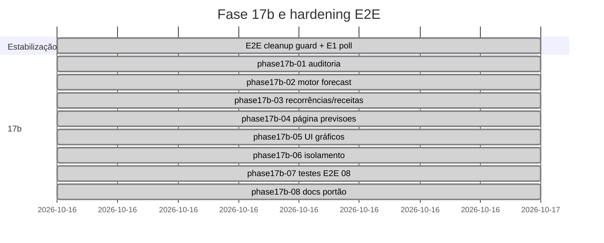

# Relatório Fase 17b — Previsões determinísticas de tesouraria

## Resumo executivo

A Fase 17b entrega previsões de tesouraria **determinísticas** (7–365 dias) integradas em `/previsoes`, sem machine learning e **sem criar transações**. O saldo real soma contas via motor existente; o saldo projetado aplica apenas ocorrências de receita `EXPECTED` e despesas recorrentes `EXPECTED`/`POSTPONED`. A etapa prévia endureceu E2E: limpeza limitada ao prefixo `E2E17a-` com guarda de ambiente, e E1 estabilizado com `expect.poll`.

**Portão (sessão de fecho):** `pnpm lint`, `pnpm typecheck`, `pnpm test` (**118** unitários), `pnpm build`, `CI=1 pnpm test:e2e` (**35** testes, **3×** consecutivas, 0 failed, 0 skipped, ~27–28 s cada).

**Migrações Prisma:** nenhuma (forecast calculado em tempo real; índices existentes em `IncomeOccurrence` e `RecurringExpenseOccurrence`).

## Timeline

## Tabela 1 — Entregáveis por tarefa

| Tarefa | Entregável | Estado |
|--------|------------|--------|
| Estabilização E2E | `e2e/global-setup.ts` + guard; `07` E1 poll | Concluído |
| phase17b-01 | Arquitetura: motor puro + serviço + UI; sem persistência forecast | Concluído |
| phase17b-02 | `src/lib/finance/treasury-forecast.ts` | Concluído |
| phase17b-03 | `collectTreasuryForecastEvents` (receitas + recorrências) | Concluído |
| phase17b-04 | `src/app/previsoes/page.tsx`, horizonte `?horizon=` | Concluído |
| phase17b-05 | `TreasuryForecastPanel` (Recharts + testids) | Concluído |
| phase17b-06 | `workspace-isolation.test.ts` + auth servidor | Concluído |
| phase17b-07 | `treasury-forecast.test.ts`, `e2e/08-treasury-forecast.spec.ts` | Concluído |
| phase17b-08 | `FINANCIAL_RULES.md`, `PROGRESS.md`, `TESTING.md`, este relatório | Concluído |

## Tabela 2 — Testes e resultado esperado

| Teste | Resultado esperado |
|-------|-------------------|
| Exemplo 1500+500−45−70 | `1885.00` projetado |
| Horizontes 7/30/…/365 | Clip 1–365; UI selector |
| Receita EXPECTED | Inflow no forecast |
| Despesa recorrente EXPECTED | Outflow no forecast |
| Ocorrência PAID | Excluída na query Prisma (`status` filter) |
| POSTPONED | Incluída na query |
| Transferência interna | Saldo agregado 1500 (900+600 após transfer −100/+100) |
| Timezone civil | `treasuryHorizonStart/End` + `civil-date` |
| Decimal | `decimal.js` / `addMoney` |
| Isolamento workspace | `getTreasuryForecast(maria, joaoWs)` → null |
| E2E João | `treasury-real-balance`, `treasury-projected-balance` visíveis |
| E2E Maria | Previsões no workspace próprio (sem dados João) |
| Idempotência forecast | Leitura pura; sem writes |
| Concorrência | Sem estado partilhado mutável no serviço |

## Tabela 3 — Prioridades

| ID | Severidade | Item | Mitigação |
|----|------------|------|-----------|
| P0 | — | (nenhum aberto no fecho) | — |
| P1 | Médio | Passivos futuros não entram no forecast | Documentado; calendário de passivos = fase futura |
| P1 | Médio | `getTreasuryForecastAllHorizons` faz N consultas | Aceitável para 6 horizontes; cache futuro opcional |
| P2 | Baixo | Amortização só no caixa realizado | Alinhado com regras 17b |
| P2 | Baixo | Endpoint REST dedicado | Server Components + GET `?horizon=` suficiente |

## Ficheiros principais

| Ficheiro | Função |
|----------|--------|
| `src/lib/finance/treasury-forecast.ts` | Motor de projeção |
| `src/server/services/treasury-forecast.ts` | Agregação BD + saldos |
| `src/app/previsoes/page.tsx` | Página horizontes |
| `src/components/forecast/treasury-forecast-panel.tsx` | KPIs + gráfico |
| `e2e/08-treasury-forecast.spec.ts` | E2E 17b |
| `e2e/global-setup.ts` | Limpeza segura E2E |

## Riscos residuais

- Ambientes com BD não-demo e `FINTWIN_ALLOW_E2E_CLEANUP=yes` por engano — mitigado por aviso no log e documentação.
- Divergência entre `scheduledFor` UTC e dia civil — mitigado por filtros alinhados ao início do dia civil Lisboa no serviço.

## Evidências

| Execução | Comando | Resultado |
|----------|---------|-----------|
| Unitários | `pnpm test` | 39 ficheiros, **118** passed |
| E2E #1 | `CI=1 pnpm test:e2e` | **35** passed (28.3 s) |
| E2E #2 | idem | **35** passed (26.7 s) |
| E2E #3 | idem | **35** passed (27.1 s) |

Correção E1: poll deixou de fazer `goto` em loop (Suspense «A carregar…»); usa `reload` + heading «Recorrências».

- Traces: `trace: on-first-retry` em `playwright.config.ts` (sem falhas nesta sessão).
- Testes novos: `e2e/08-treasury-forecast.spec.ts`, `src/lib/e2e/e2e-cleanup-guard.test.ts`.

**Nota:** Fase 17c / ML **não iniciada**, conforme pedido.
