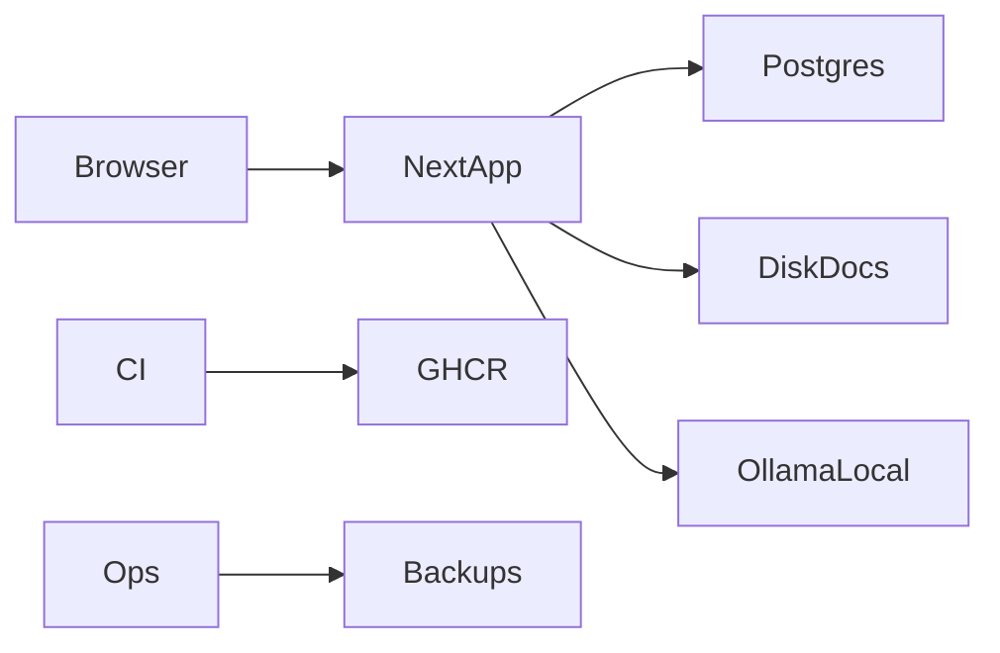

# Threat modeling (STRIDE)

Âmbito: FinTwin modular monolith (Next.js + PostgreSQL + Ollama local + uploads privados).

## Actores

| Actor | Intenção |
|-------|----------|
| Utilizador autenticado | Uso legítimo multi-workspace |
| Utilizador malicioso (conta roubada) | Exfiltrar / alterar dados do workspace |
| Atacante externo anónimo | Brute-force, injection, upload malware |
| Insider operador | Acesso infra/backup |
| Fornecedor (dependência) | Compromisso supply chain |

## Diagrama (simplificado)

## STRIDE por componente

| Componente | S | T | R | I | D | E |
|------------|---|---|---|---|---|---|
| Login/MFA | ✓ | ✓ | ✓ | ✓ | | ✓ |
| API financeira | | ✓ | ✓ | ✓ | ✓ | |
| Upload documentos | ✓ | | | ✓ | ✓ | |
| Workspace isolation | | | ✓ | ✓ | | ✓ |
| CI/release | | ✓ | | ✓ | ✓ | |
| Backups | | | | ✓ | ✓ | |

## Mitigações principais

- Auth Argon2id, MFA, rate limit, step-up (`docs/SECURITY_CENTER.md`).
- Autorização servidor por `workspaceId`.
- CSP, HSTS, Permissions-Policy (`src/lib/security/security-headers.ts`).
- Sniff MIME + malware scan uploads (`document-malware-scan.ts`).
- CI: audit, CodeQL, gitleaks, SBOM, imagem assinada Cosign.
- ASVS L2 baseline: `docs/OWASP_ASVS_L2.md`.

## Revisão

Semestral ou após nova superfície (Open Banking, multi-tenant público).
